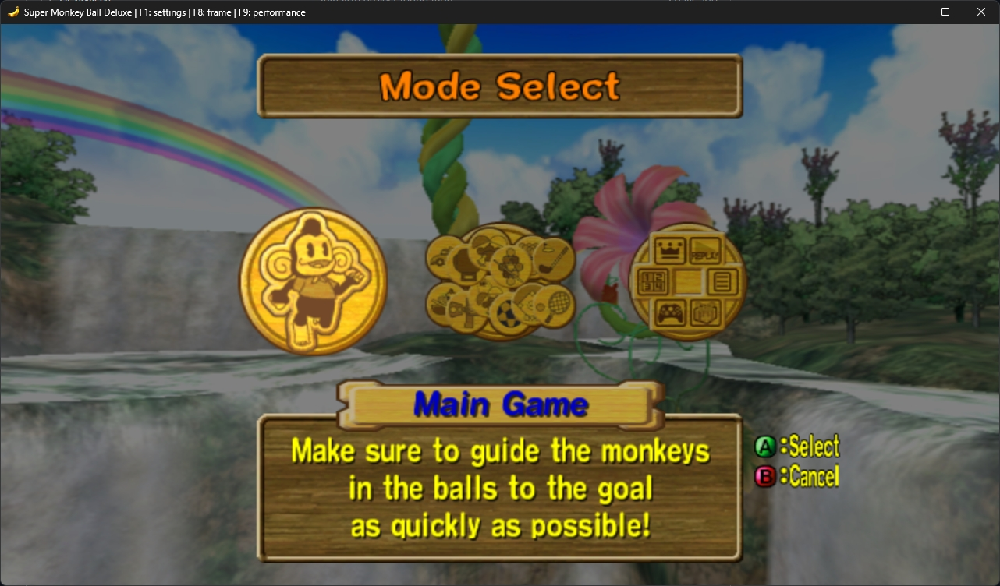
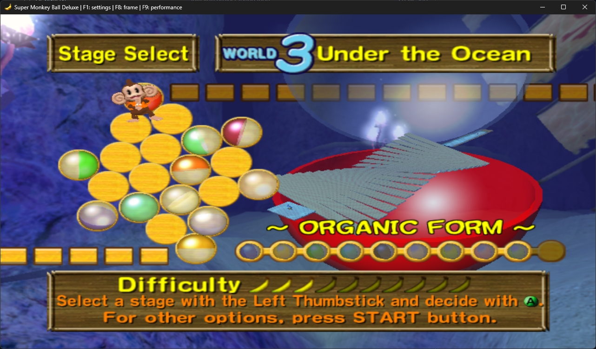
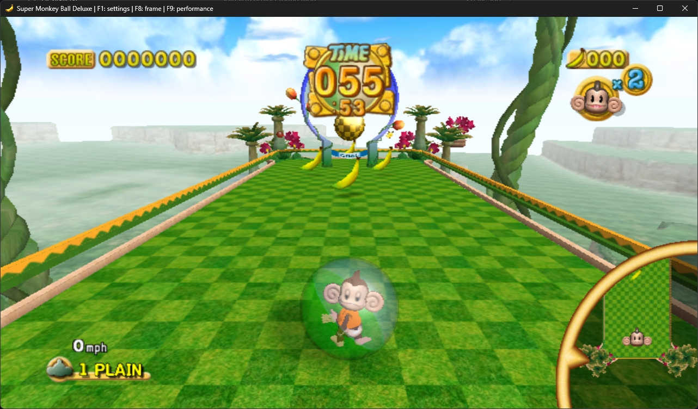

<p align="center">
  
</p>

<h1 align="center">Super Monkey Ball Deluxe — Static Recompilation</h1>

<p align="center">
  <em>From the creator of the <a href="https://github.com/timftw21/burnout2-recompilation">Burnout 2 recompilation</a>.</em>
</p>

An unofficial native version of the original Xbox game for Windows, built around accurate gameplay, original presentation, and enhancements. This fan project is independent of SEGA. You must provide your own US Xbox game disc image. Original game files are not distributed here.

**0.4.0 is the latest public development release.** Bugs, slowdowns, and stops in untested game modes are still possible. Linux and macOS are planned targets; the current game build requires Windows x64.

## AI disclosure

OpenAI Codex has assisted with development and research. Changes are checked using native diagnostics, scripted gameplay, and rendering comparisons. Those checks establish specific results, rather than complete game compatibility.

## Screenshots

| Mode Select | Stage Select | Gameplay |
| :---: | :---: | :---: |
| [](resources/screenshots/mode-select.jpg) | [](resources/screenshots/stage-select.jpg) | [](resources/screenshots/gameplay.jpg) |

## Current status

### Changes in 0.4.0

- Implemented a slew of performance optimizations. Enjoy much higher performance :3
- Addressed more timing issues across the game. Monkey Baseball and Monkey Tennis now behave correctly at higher refresh rates.
- Added a render distance override to Enhancements. It's recommended to use this enhancement at higher internal resolutions.

### Known issues

- Timing issues in replays.
- Your antivirus software may flag the setup executable as a virus. It's a false positive.
- Other issues that I'm sure I'll find.

### What works

- Startup, opening movies, and the main menus.
- Story Mode, Practice Mode, Challenge Mode, most minigames, and other miscellaneous features. Competition mode still needs to be tested.
- Keyboard and gamepad input, pause/resume, and native audio playback.
- Creating and reopening game saves.
- Saved display, refresh-rate, audio, game-file, and keyboard/controller bindings.
- Original 4:3, widescreen 16:9, and ultrawide 21:9 options; 1×–4× internal resolution, FXAA/MSAA, and anisotropic filtering.
- Fresh scene rendering above 60 Hz, with the original rule and input timing preserved.
- Frame captures, offline rendering replay, and CPU/GPU performance reports.

### What still needs work

- Testing every stage, game mode, and progression path. Party games have not been fully validated.
- Remaining original native Xbox services.
- Wider visual, audio, and gameplay comparisons against the original Xbox release.
- Sustained 360 Hz performance. Selecting a refresh rate does not guarantee the hardware can reach it.
- Native Linux and macOS implementation and hardware validation.

## Getting started

### Windows x64

You need a Direct3D 11-capable graphics card and an XISO image of the **US Xbox release of Super Monkey Ball Deluxe**. A full raw-disc dump must first be converted to XISO. The executable is checked against [the supported-target registry](knowledge/supported_target.json).

**[Download the 0.4.0 Windows installer](https://github.com/timftw21/smbd-recompilation/releases/download/v0.4.0/smbd-0.4.0-windows-x64-setup.exe)** · [Release notes and SHA-256 checksum](https://github.com/timftw21/smbd-recompilation/releases/tag/v0.4.0)

1. Run the installer and select your US Xbox XISO image.
2. Choose an installation folder. You can keep a copy of the image with the game and create a desktop shortcut.
3. Choose **Install**. The progress panel shows verification, extraction, and copying as they happen.
4. Choose **Play game**, or launch it later from the Start menu or desktop shortcut.

The installer supplies the compiled game and runtime libraries. It checks your image and prepares the game files automatically. If you leave the image in its original location, keep it available while playing. The default installation is in `%LOCALAPPDATA%\Programs\Super Monkey Ball Deluxe`.

### Building from source

Install these build prerequisites:

- Visual Studio 2026 C++ build tools and the Windows SDK, including MASM.
- LLVM 22.1 or newer, including `clang-cl`, LLD, and `llvm-lib`.
- CMake 4.2 or newer, Git, PowerShell 7 or newer, and JDK 21 or newer.
- Ninja; the build script can use the copy included with Visual Studio.

Clone the repository, then run from its folder in PowerShell:

```powershell
git clone https://github.com/timftw21/smbd-recompilation.git
cd smbd-recompilation
.\tools\Build.ps1 -Disc 'C:\Games\Super Monkey Ball Deluxe (USA).xiso.iso' -AllowPartial -Workers 3
.\Play.cmd
```

Replace the example disc path with your own. The first build downloads pinned dependencies, prepares the disc, runs offline analysis, and compiles the game. Python is not required. Unsupported paths stop with an error.

In **Game Files**, select your disc image and the prepared `data/local/default.xbe`, validate the files, then choose **Play game**. Keep the source folder, build output, and disc image available. See [BUILDING.txt](BUILDING.txt) for the build stages and developer commands.

### Linux and macOS

These remain development targets, not supported installation options. The intended graphics backends are DXVK Native/Vulkan on Linux and DXMT/Metal on macOS, without Wine. The current CMake game-batch build explicitly requires Windows x64; no native Linux or Mac gameplay result is claimed.

## Game settings

Press **F1** or **Esc**, or the gamepad **Back** button, to open settings. Preferences save automatically.

Use the bottom row to close settings, restart the running game, restore defaults, or **Exit game**.

- **Game Files:** Select and validate the XISO and executable.
- **General:** Choose a refresh limit or Unlimited, and toggle the frame-rate display. V-sync can impose an additional limit.
- **Audio:** Adjust master volume, mute, or mute when the window loses focus.
- **Graphics:** Set aspect ratio, fullscreen, and V-sync.
- **Enhancements:** Choose 1×–4× internal resolution, FXAA or supported MSAA levels, and anisotropic filtering up to 16×. The render distance override is recommended at higher internal resolutions. These settings and aspect ratio apply immediately.
- **Controls:** Rebind keyboard keys, controller buttons, and stick directions, clear bindings, or restore the defaults.
- **Diagnostics:** Capture a frame or record a slowdown.
- **Mods:** List the mods built into this copy of the game, with their previews and details, and switch each on or off. A normal build has none; see [osmod/README.md](osmod/README.md) to add some.

Higher rendering rates produce new scene updates. Game rules and input retain their original 60 Hz clock; audio keeps its own sample clock and movies retain their source cadence.

## Controls

Connected gamepads use the left stick for stage tilt, **A** to confirm, **B** to go back, and **Start** to pause.

| Action | Keyboard |
| --- | --- |
| Tilt the stage | W / A / S / D |
| Navigate menus | Arrow keys |
| Confirm / A | Space |
| Back / B | Left Shift |
| Start / Pause | Enter |
| Open settings | F1 / Esc |
| Capture a frame | F8 |
| Start / save performance recording | F9 |

Change game bindings in **Controls**. Movement keys apply full tilt. Short taps allow finer control. Game input is held neutral while settings are open.

## Saves and updates

Game saves and the local storage identity are in `data/user` inside your installation or source folder. **Back up that entire folder, including `storage.key`.** Preferences and control bindings are in `data/local/settings.cfg`.

For installed builds, close the game and run the newer installer using the same installation folder. Updates preserve saves and preferences. Uninstall through Windows **Installed apps**; saved games, preferences, and your original source image are kept. An image copied into the installation folder is removed during uninstall.

For source builds, close the game, update the source, preserve your `data` and `build` folders, rebuild, then launch `Play.cmd` again. When moving the project or disc image, update the paths in Game Files.

## Development and credits

Game code is translated ahead of time into native C++23. Xbox services use native implementations; the game does not run a CPU interpreter. Extraction, analysis, rendering inspection, and diagnostics share the project's native core.

- [Burnout 2 recompilation](https://github.com/timftw21/burnout2-recompilation): reusable extraction, CPU, and recompilation foundations.
- SDL3: windows, controllers, and audio.
- Dear ImGui: settings and diagnostic controls.
- Zydis and Ghidra: offline instruction analysis and generation.
- Direct3D 11 / HLSL: the current Windows renderer.
- XboxDev, xemu, and Cxbx-Reloaded: documented system and graphics behavior used as research references.

See [DESIGN.txt](DESIGN.txt), the [research notes](knowledge/), and [THIRD_PARTY_NOTICES.txt](THIRD_PARTY_NOTICES.txt) for requirements, evidence, and dependency notices. Disc images, extracted game assets, generated game sources, saves, and local diagnostics are intentionally excluded from this repository.
